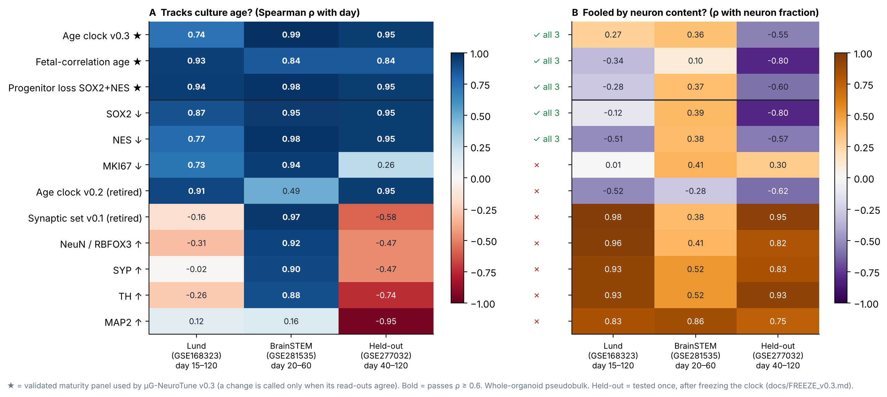

# µG-NeuroTune

[](https://doi.org/10.5281/zenodo.24340201)



**Is your midbrain organoid really maturing, or just stressed?**

µG-NeuroTune is an open, validated scorecard that profiles human midbrain (dopaminergic)
organoids on three axes from RNA-seq: **Neuronal age (validated clock)**, **Dopaminergic fidelity** and
**Stress/Hypoxia**. It ships with a spaceflight module, built around the NASA ISS organoid
experiment (Marotta et al. 2024; GEO GSE259421), and an **oxygen-transport model** of the
flight culture vials.

> Why: organoids are too immature to model Parkinson's disease well, and "maturation-like"
> gene expression can also come from cellular stress or low oxygen (Bhaduri et al. 2020;
> Vértesy et al. 2022). The ISS study reported faster maturation in orbit. This tool asks
> whether that signal is *faithful* maturation, and what a future mission must control.

## What's inside
| Step | What it does | Module / command |
|---|---|---|
| A · validate | Validated maturity panel (age clock v0.3, fetal-correlation age, progenitor loss), benchmarked on 3 labs | `mugnt validate`, `maturity.py` |
| B · anchor | Estimates the fetal age (PCW) each organoid resembles | `mugnt anchor` |
| C · compare | LEO vs ground within cell line × microglia strata; permutation p, bootstrap CI, FDR; pre-registered verdict | `mugnt compare` |
| D · hypoxia | Hypoxia-adjusted maturation test + O₂ physics model of the vial | `mugnt compare`, `o2model/` |
| E · design | Power for the next mission (donors × organoids) | `mugnt power` |
| F · app | Browser scorecard: upload counts, get the profile (data stays local) | `webapp/index.html` |

## Quick start
```bash
pip install git+https://github.com/elenipatsiala/mug-neurotune
# or, to run the tests and examples:
git clone https://github.com/elenipatsiala/mug-neurotune && cd mug-neurotune && pip install -e .            # numpy, scipy, pandas, matplotlib
mugnt demo --out results/demo_synthetic      # end-to-end on SYNTHETIC data with known truth
pytest -q                                    # 17 tests (~30 s)
python o2model/run_o2.py results/o2 3000     # O2 Monte Carlo + figures
```
Real data: follow **`docs/DATA_GUIDE.md`** (exact files and commands).

## Current status (v0.3.0, 2026-11-17)
* ✅ **Validated maturity panel**: three read-outs that each track culture age in **three midbrain-organoid
  time courses from three labs** (ρ 0.74–0.99), including a **held-out test run after freezing the clock**
  (ρ = 0.95). See **`docs/BENCHMARK.md`** and `results/real/fig_benchmark.png`.
* ✅ **Benchmark finding:** NeuN, SYP, TH and MAP2, the markers often shown as "maturity", track neuron content,
  not age (they fail in 2 of 3 datasets).
* ✅ **NASA ISS organoids (GSE259421):** no consistent evidence of faster maturation (verdict "insufficient
  evidence" in dopaminergic and cortical organoids). Robust signals: glycolysis ↑ and p53/DNA-damage ↓,
  same direction in every cell line.
* ✅ Mission design: 2 donors gives ≤ 28% power for a 2-week maturation effect; 4 donors × 4 organoids per arm: 88%.
* ✅ 19 tests; classifier calibrated on 800 simulated missions. Full write-up: **`docs/RESULTS.md`**.

## Design choices that make it trustworthy
* **Pre-registered** gene sets and decision rules (`docs/PREREGISTRATION.md`), fingerprinted
  in every output.
* **Non-overlapping programs** and **background-referenced ranks**, so one program changing
  cannot fake changes in another (a test enforces this exactly).
* **Within-stratum statistics**, so a donor difference can never look like a LEO effect.
* **Every robustness check reported**, none selected: z-score method, leave-one-gene-out,
  per line, per microglia status.
* **Explicit non-claims:** transcripts ≠ function; LEO ≠ microgravity only; 2 donors ≠ general.

## Repository map
```
mug_neurotune/   genesets · io · scoring · validate · anchor · compare · power · plots · cli · synthetic
o2model/         vial_o2.py (model) · run_o2.py (Monte Carlo, figures)
webapp/          index.html (built) · template.html · core.js (scoring, identical to Python)
tests/           ground-truth tests
examples/        calibration.py
docs/            DATA_GUIDE · PREREGISTRATION · O2_MODEL · PREPRINT_OUTLINE
results/         demo_synthetic/ (SYNTHETIC) · o2/ · calibration.json
```

## Roadmap
* **v0.4:** second-trimester fetal data for the clock, cortical-organoid benchmark, expert review of gene sets, preprint.
* **Phase 2 Create:** O₂-controlled culture for microgravity. Use the O₂ model to size a perfused
  or gas-permeable vessel that keeps the organoid normoxic in µg, plus a ground test plan.

## Cite
Patsiala, E. (2026). *µG-NeuroTune: a validated maturation, dopaminergic-fidelity and stress scorecard for human midbrain organoids* (v0.3.0). Zenodo. https://doi.org/10.5281/zenodo.24340201

Earlier version: v0.2.0, https://doi.org/10.5281/zenodo.24319198

See also `CITATION.cff`. Primary data: Marotta D. et al. (2024) *Stem Cells Transl Med* 13(12):1186–1197,
doi:10.1093/stcltm/szae070.

License: MIT.
